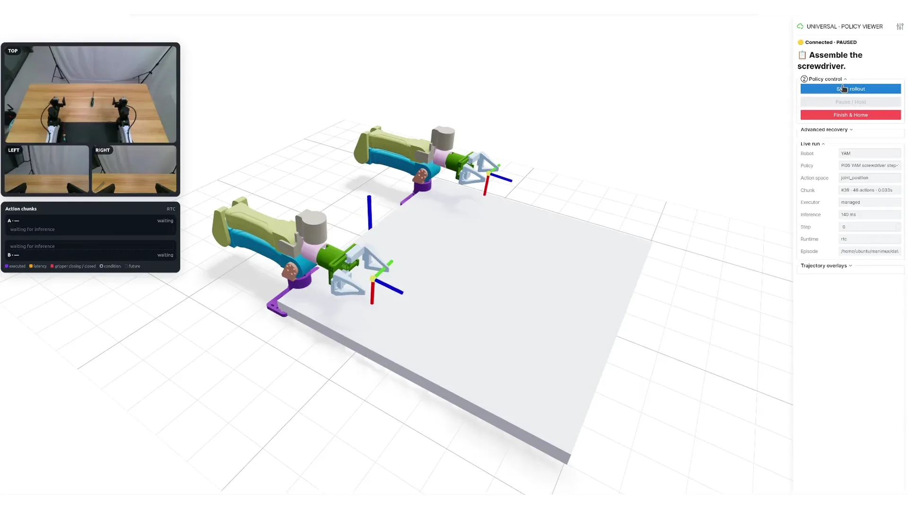
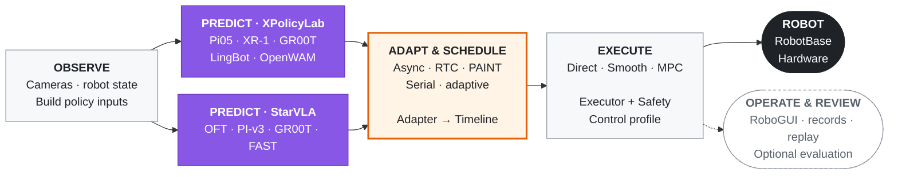

<div align="center">

<p></p>

**Any embodiment. Any policy. Any inference strategy.**

ManiMux is an **extensible real-world manipulation harness** that **standardizes**
deployment and experiment workflows across embodiments, policies, and inference strategies.
Built around **RoboGUI**, it brings together **live digital twin visualization**
and a runtime designed for **100–200 Hz command execution**.

**Policy × Runtime × Embodiment**

[](https://sii-liulab.github.io/manimux/)
[](https://sii-liulab.github.io/manimux/#manimux)
[](.agents/skills/manimux-development/SKILL.md)

[](#included-integrations)
[](#included-integrations)
[](#included-integrations)
[](https://github.com/SII-LiuLab/manimux/commits/main/)

[Quick start](#quick-start) · [Architecture](#architecture) · [Integrate](#integrate) · [Documentation](https://sii-liulab.github.io/manimux/) · [Citation](#citation)

</div>

> **[Read the ManiMux Guide →](https://sii-liulab.github.io/manimux/) · [HTML source](guideline.html)**
> Installation, station setup, deployment recipes, RoboGUI workflows and integration protocols.
> For agent-led development, start with the [development skill](.agents/skills/manimux-development/SKILL.md).

## News

- **2026-10-13** — Added [execution-qualified evaluation](guideline.html#report-metric-definitions): chunk handoff jumps, 10/20/30-step overlap and segmented reference smoothness, with versioned offline HTML reports.
- **2026-10-12** — Added [task and method switching](guideline.html#experiment-lists) from a config list, template-driven partial scores and explicit warmup controls.

- **2026-10-02** — Added [ALOHA-AgileX](.agents/skills/manimux-station-setup/references/aloha.md) and [PiPER](.agents/skills/manimux-station-setup/references/piper.md) RoboGUI demos, plus experimental [ARX X5 / PiPER controllers](.agents/skills/manimux-station-setup/references/can-arms.md). Hardware validation is pending.
- **2026-10-01** — The [ManiMux Guide](https://sii-liulab.github.io/manimux/) is live, covering setup, deployment, RoboGUI and integration protocols.
- **2026-10-01** — Updated [research workflows](guideline.html#experiments) and [agent integration guides](.agents/skills/manimux-development/references/README.md) for free exploration, study templates and component development.

## RoboGUI



[▶ Watch the real-robot demo](assets/manimux_2026-09-05_23-17-35-00.00.03.144-00.00.34.914-seg1-00.00.02.596-00.00.34.966.mp4)

**Prepare Run / Prepare Experiment → Activate Warmup → Start → Finish → Score.**
Warmup is shown when configured. Free runs need no scoring; experiments read their
score options from a YAML rubric. Recorded trajectories replay
in a separate, hardware-free view. [Research workflow →](guideline.html#experiments)

## Included integrations

- **Policies with robot deployment recipes (9):** Pi05, DP, SAPolicy, ABC-DiT, GR00T N1.7, LingBot-VLA2, Xiaomi XR-1, UMI DP and OpenWAM.
- **Policies with offline recipes (5):** Isaac 0.5 and StarVLA's QwenOFT, QwenPI-v3, QwenGR00T and QwenFast.
- **Base inference modes (8), plus opt-in combinations:** Serial, asynchronous chunking, RTC, ACT temporal ensembling, AAC, PAINT, AutoHorizon and BID backward-only.
- **Hardware integrations (4):** YAM, Tianji–TacCap, and experimental ARX X5 / PiPER. **Executors:** Direct, Smooth and MPC.

[ALOHA-AgileX follower-arm assets](.agents/skills/manimux-station-setup/references/aloha.md) and
[standard PiPER assets](.agents/skills/manimux-station-setup/references/piper.md) are available for offline RoboGUI
preview and replay. Experimental [ARX X5 / PiPER SDK adapters](.agents/skills/manimux-station-setup/references/can-arms.md)
include station templates and offline validation; physical deployment remains unvalidated.
The [SDK installation guide](.agents/skills/manimux-station-setup/references/robot-sdks.md) covers their external dependencies.

Policy serving uses **XPolicyLab** or **StarVLA**. Counts describe included integrations,
not all model × method × robot combinations or completed hardware validation.
See the [support catalog](guideline.html#support) for scope and recipes.
Evaluation is optional; choose your own research protocol and metrics.

## Inference strategies and combinations

Choose a base algorithm, a request schedule, and optional ACT fusion. The eight base
modes remain available; combinations reuse their existing samplers and do not require
changes to XPolicyLab or model weights.

| Purpose | Modes | Behavior |
| --- | --- | --- |
| Execution scheduling | Serial, asynchronous chunking | Infer after the selected prefix finishes, or overlap inference with execution |
| Consistency between chunks | RTC, PAINT, ACT temporal ensembling, BID backward-only | Guide sampling, adjust initial noise, average aligned predictions, or select a coherent candidate |
| Adaptive execution length | AAC, AutoHorizon | Select a source prefix using candidate uncertainty/motion or action attention |

The current compatibility matrix is:

| Base algorithm | Serial | Async `single_inflight` | Async `multi_inflight` | Optional ACT fusion |
| --- | --- | --- | --- | --- |
| Ordinary chunking (`serial` / `async`) | Yes | Yes | Yes | Select `act_temporal_ensemble` |
| ACT temporal ensembling | **New** | Yes | Yes | Already enabled |
| RTC | — | Yes | Yes | **New** |
| PAINT | — | Yes | **New** | **New** |
| BID backward-only | Yes | Yes | Yes | **New** |
| AAC | Yes | **New** | **New** | **New** |
| AutoHorizon | Yes | **New** | **New** | **New** |

BID also supports AAC adaptive horizons, with optional ACT fusion. For deadline
aliases, decoding requirements and YAML examples, use the [inference guide](guideline.html#algorithms)
and [supported combinations](guideline.html#optional-algorithm-composition).

## Architecture

Model frameworks own inference. ManiMux owns observation/action adaptation, scheduling,
execution and experiment operation. Strategies decide when to request and hand off chunks;
executors turn timeline references into commands.



XPolicyLab and StarVLA have independent serving environments and ManiMux clients.
A new framework can implement the same client interface. A new robot implements component
and assembly protocols. [Extension map →](.agents/skills/manimux-development/references/README.md)

## Quick start

### Explore without hardware

Python 3.11 or 3.12 and [uv](https://docs.astral.sh/uv/) are required for these commands:

```bash
git clone https://github.com/SII-LiuLab/manimux.git
cd manimux
uv sync --dev
uv run manimux-robogui --robot yam --demo --host 127.0.0.1 --port 8086
```

Open **http://127.0.0.1:8086**. This demo displays synthetic data and the bundled YAM
model; it does not connect to a robot. Model-framework submodules and checkpoints are
only needed for the deployment path you choose.

Try the new arms in RoboGUI using the same environment:

```bash
uv run manimux-robogui --robot piper --demo --host 127.0.0.1 --port 8087
```

Open **http://127.0.0.1:8087**. Use `--robot aloha` for ALOHA-AgileX.
Both presets animate arms and grippers with synthetic data; no device SDK is needed.
ARX X5 currently has a kinematic model and experimental controller, without a
bundled RoboGUI mesh preset.

Upgrading an existing checkout? See the [RoboGUI interface migration](guideline.html#launch).

### Run on your robot

1. Select a [model/robot runbook](guideline.html#support)
   and prepare its hardware and model environments.
2. Bind devices, service addresses and checkpoint paths in your private
   [station file](.agents/skills/manimux-station-setup/references/station.md).
3. Start the camera, RoboGUI, model server and runtime using the
   [complete Pi05/YAM example](guideline.html#launch)
   or the selected model's runbook.
4. Continue in RoboGUI: select the configured task/method, prepare and run trials,
   then review records. For your own task/study, start with the
   [experiment skill](.agents/skills/manimux-experiments/SKILL.md).

`manimux serve` keeps the service available for repeated GUI-driven rollouts.
`manimux run` executes one rollout. Preparation can connect and move the selected robot
as configured; use the runbook matching your actual setup.

[Configuration explained](manimux/configs/README.md) · [Annotated experiment](manimux/configs/examples/README.md)

## Run an experiment campaign

A config list exposes **Task → Method / Config → Layout** in RoboGUI. Switch while
idle after finishing recovery and evaluation; compatible entries reuse the camera
and model services. `serve` does not start those services for you.

```bash
# From the repository root, after starting cameras, RoboGUI and the matching model:
envs/yam/.venv/bin/python -m manimux serve \
  --config-list manimux/configs/experiment_lists/yam_pi05_latest300ep.yaml
```

The current list has **five tasks × six methods**: coin, medium blocks, bottles,
rotating clock and moving cube; Serial, Async, RTC, AutoHorizon, PAINT and
backward-only BID. All entries use Direct. Checkpoint paths are deployment-specific.
[Complete launch commands](guideline.html#latest300ep-launch) ·
[Rubrics and partial scores](guideline.html#experiments)

Records go to `<run.output_dir>/session-…/rollout-…/`. Runtime completion and human
task success are separate. A report index selects exact checkpoints/settings and
recorded episodes; it is separate from the runtime scoring rubric.

```bash
envs/yam/.venv/bin/python -m manimux.evaluation \
  --task-dir data/evaluation_tasks/coin
```

Create that directory's `task.yaml` using the [report example](guideline.html#reports).
Each run writes a new HTML bundle and prints its absolute path. Reports include
human scores, execution-qualified handoff plots, reference smoothness and
10/20/30-step overlap where supported by the recording. Completion time needs an
annotation; PRM needs a separate judge run. Use `language: zh-CN` for Chinese reports.
[Metric definitions and aggregation](guideline.html#report-metric-definitions) ·
[Saved files](guideline.html#records)

## Integrate

**For users:** configure an existing combination and use RoboGUI.
**For your coding agent:** use the [development skill](.agents/skills/manimux-development/SKILL.md)
or the matching task skill below. If your tool does not discover repository skills,
ask it to read the linked `SKILL.md` explicitly.

| Task | Entry point |
| --- | --- |
| Add a robot, gripper or camera | [Component protocols](.agents/skills/manimux-development/references/components.md) |
| Add a model, framework or action adapter | [Policy protocols](.agents/skills/manimux-development/references/policies.md) |
| Add scheduling, execution or a GUI feature | [Runtime protocols](.agents/skills/manimux-development/references/runtime-config.md) |
| Connect supported hardware at another lab | [Station setup skill](.agents/skills/manimux-station-setup/SKILL.md) |
| Build a custom study, collect trials or evaluate recordings | [Experiment skill](.agents/skills/manimux-experiments/SKILL.md) |

Each integration documents its input/output semantics, owning files, YAML selection and
validation.

**Build with us.** Contributions are welcome—from new embodiments, policies, and
inference strategies to documentation and bug fixes. Start with the
[integration guide](.agents/skills/manimux-development/references/README.md), follow the shared protocols, and see
[Contributing](.agents/skills/manimux-development/references/README.md#contributing) for the expected handoff.

## Support and evidence

See the [support catalog](guideline.html#support) for model, hardware and method
runbooks. Capabilities vary by checkpoint and backend; an integration does not imply
that every model × robot × algorithm combination has been tested on hardware.
ManiMux is under active development. Each deployment guide states its validation scope.

## Citation

If ManiMux supports your research, please cite:

**ManiMux: An Extensible Real-World Manipulation Harness**

```bibtex
@misc{manimux2026,
  title = {{ManiMux}: An Extensible Real-World Manipulation Harness},
  year = {2026},
  howpublished = {GitHub repository},
  url = {https://github.com/SII-LiuLab/manimux}
}
```

Please also cite the components, models and methods used in your work:
[XPolicyLab](https://github.com/XPolicyLab/XPolicyLab), [StarVLA](https://github.com/starVLA/starVLA) and [PRM-as-a-Judge](https://github.com/YuyangLiu2003/PRM-as-a-Judge).

<details>
<summary>Official BibTeX for related projects (cite those you use)</summary>

[XPolicyLab](https://arxiv.org/abs/2608.09892)

```bibtex
@article{community2026xpolicylab,
  title={{XPolicyLab}: A Unified Standard and Open Ecosystem for Robot Policy Evaluation and Deployment},
  author={Community, XPolicyLab and Chen, Tianxing and Chen, Yue and Nian, Tian and Cai, Zijian and Chen, Guangyu and Lin, Wenwei and Liang, Qiwei and Xiang, Peicheng and Su, Kailun and others},
  journal={arXiv preprint arXiv:2608.09892},
  year={2026}
}
```

[StarVLA](https://arxiv.org/abs/2604.05014)

```bibtex
@article{community2026starvla,
  title={StarVLA: A Lego-like Codebase for Vision-Language-Action Model Developing},
  author={Community, StarVLA},
  journal={arXiv preprint arXiv:2604.05014},
  year={2026},
  eprint={2604.05014},
  archivePrefix={arXiv},
  primaryClass={cs.RO}
}
```

[PRM-as-a-Judge 1.5 — toolkit report](https://arxiv.org/pdf/2608.14284)

```bibtex
@article{liu2026prmjudge15,
  title   = {PRM-as-a-Judge 1.5: A Toolkit for Robot Process Assessment},
  author  = {Liu, Yuyang and Shen, Yanqing and Chen, Ruike and Zhao, Jifan and Tian, Yuxuan and Zhang, Yichi and Long, Tianfeng and Yin, Zixuan and Wang, Yipu and Qin, Ziheng and Tan, Wenxing and Shi, Yang and Cao, Mingyu and Xiao, Runze and Wang, Ziqi and Yin, Zhixin and Chu, Shiwei and Zhang, Yi-Fan and Mu, Yao and Ji, Yuheng and Wang, Yihao and Yan, Jun and Wang, Zhongyuan and Wang, Pengwei and Zheng, Xiaolong},
  journal = {arXiv preprint arXiv:2608.14284},
  year    = {2026},
  url     = {https://arxiv.org/pdf/2608.14284}
}
```

[PRM-as-a-Judge — original method](https://arxiv.org/abs/2603.21669)

```bibtex
@article{ji2026prmjudge,
  title   = {PRM-as-a-Judge: A Dense Evaluation Paradigm for Fine-Grained Robotic Auditing},
  author  = {Ji, Yuheng and Liu, Yuyang and Tan, Huajie and Huang, Xuchuan and Huang, Fanding and Xu, Yijie and Chi, Cheng and Zhao, Yuting and Lyu, Huaihai and Co, Peterson and others},
  journal = {arXiv preprint arXiv:2603.21669},
  year    = {2026}
}
```

</details>

[Third-party notices](licenses/THIRD_PARTY_NOTICES.md) · [Upstream licenses](licenses) · [Documentation](https://sii-liulab.github.io/manimux/)

## License

[](pyproject.toml)
[](LICENSE)

ManiMux is licensed under [MIT](LICENSE). Third-party frameworks, SDKs and assets
retain their own licenses; see [third-party notices](licenses/THIRD_PARTY_NOTICES.md).
