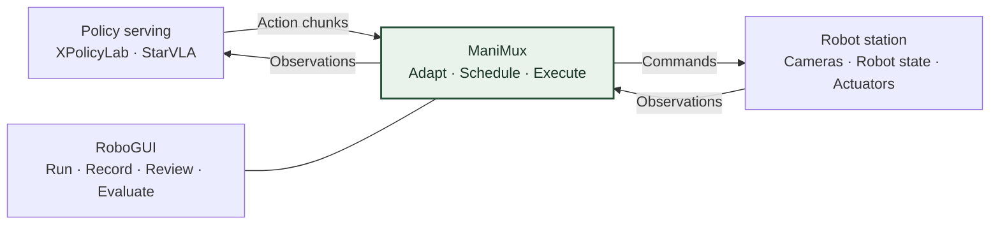

<div align="center">

<p><a href="https://sii-liulab.github.io/manimux/"></a></p>

### Real robot experiments. One inference harness.

An open-source harness for real-world manipulation inference and experiment management.

**[Website](https://sii-liulab.github.io/manimux/)** · **[Documentation](https://sii-liulab.github.io/manimux/guideline.html)** · **[Quick start](#quick-start)** · **[Demo](https://sii-liulab.github.io/manimux/#recordings)**

[](pyproject.toml)
[](LICENSE)

</div>


**RoboGUI** brings camera views, robot state, action chunks, and recorded trajectories
into one workspace.

[Watch the real-robot demo](assets/manimux_2026-09-05_23-17-35-00.00.03.144-00.00.34.914-seg1-00.00.02.596-00.00.34.966.mp4) · [Experiment workflow](https://sii-liulab.github.io/manimux/guideline.html#experiments)

## What you can do

- **Run policies on real robots.** Deploy supported model and station configurations,
  inspect live observations, and control runs through RoboGUI.
- **Study inference strategies.** Compare supported scheduling and sampling methods
  within a shared experiment workflow.
- **Keep experiments traceable.** Save run configurations, trajectories, recordings,
  and task-defined human evaluations for review and comparison.

## Quick start

Try RoboGUI without hardware. Requires **Python 3.11 or 3.12** and [uv](https://docs.astral.sh/uv/).

```bash
git clone https://github.com/SII-LiuLab/manimux.git
cd manimux
uv sync --dev
uv run manimux-robogui --robot yam --demo --host 127.0.0.1 --port 8086
```

Open **http://127.0.0.1:8086**. The preview uses synthetic data and does not connect
to a robot. Model environments and checkpoints are needed only for real deployment.

**Ready for hardware?** Follow a [supported deployment recipe](https://sii-liulab.github.io/manimux/guideline.html#support)
and the [station setup guide](https://sii-liulab.github.io/manimux/guideline.html#configuration).

## Included integrations

| Area | Examples |
| --- | --- |
| Embodiments | YAM, Tianji–TacCap; experimental ARX X5 and PiPER adapters |
| Policies | Pi05, diffusion policies, GR00T, LingBot-VLA2, XR-1, and more |
| Inference | Serial and async chunking, RTC, ACT temporal ensembling, PAINT, and more |

These are individual integrations, not a fully compatible cross-product. Support
varies by checkpoint, backend, adapter, and station; experimental hardware adapters
have not completed physical validation.

[Full support catalog and deployment recipes](https://sii-liulab.github.io/manimux/guideline.html#support) · [Supported inference combinations](https://sii-liulab.github.io/manimux/guideline.html#optional-algorithm-composition)

## Architecture

ManiMux sits between policy servers and robot hardware, coordinating observation/action
adaptation, scheduling, execution, and experiment records. Model frameworks own inference;
RoboGUI provides the operator workspace.



[Architecture and extension protocols](.agents/skills/manimux-development/references/README.md) · [Inference guide](https://sii-liulab.github.io/manimux/guideline.html#algorithms)

<a id="integrate"></a>

## Contributing

Contributions to robot and policy integrations, inference strategies, RoboGUI,
and documentation are welcome. Start with the [contribution guide](.agents/skills/manimux-development/references/README.md#contributing).
For agent-assisted development, use the [development skill](.agents/skills/manimux-development/SKILL.md).

**Latest update · 2026-10-18:** The [ManiMux website](https://sii-liulab.github.io/manimux/) and dedicated [user guide](https://sii-liulab.github.io/manimux/guideline.html) are live.

## Developer community

Join the **ManiMux developer WeChat group** to discuss integrations, experiments,
and contributions. Scan the QR code below in WeChat.

<p align="center">
  
</p>

This invitation is valid until **October 28, 2026**. If it has expired, please open
[a GitHub issue](https://github.com/SII-LiuLab/manimux/issues) to request an updated invitation.

## Citation

If ManiMux supports your research, please cite this repository. The paper link is forthcoming.

```bibtex
@misc{manimux2026,
  title = {{ManiMux}: An Open-Source Harness for Real-World Manipulation Inference and Experiment Management},
  year = {2026},
  howpublished = {GitHub repository},
  url = {https://github.com/SII-LiuLab/manimux}
}
```

Please also cite the components, models and methods used in your work:
[XPolicyLab](https://github.com/XPolicyLab/XPolicyLab), [StarVLA](https://github.com/starVLA/starVLA) and [PRM-as-a-Judge](https://github.com/YuyangLiu2003/PRM-as-a-Judge).

## License

ManiMux is licensed under [MIT](LICENSE). Third-party frameworks, SDKs and assets
retain their own licenses; see [third-party notices](licenses/THIRD_PARTY_NOTICES.md).
