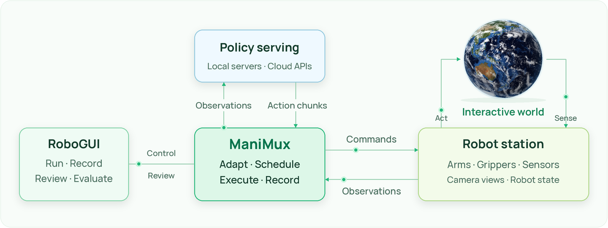

<div align="center">

<p><a href="https://sii-liulab.github.io/manimux/"></a></p>

### Real robot experiments. One inference harness.

An open-source harness for real-world manipulation inference and experiment management.

**[Website](https://sii-liulab.github.io/manimux/)** · **[Documentation](https://sii-liulab.github.io/manimux/guideline.html)** · **[Quick start](#quick-start)** · **[Try GUI](#try-robogui-offline)** · **[中文](README.zh-CN.md)**

[](pyproject.toml)
[](LICENSE)
[](#contributing)
[](https://github.com/SII-LiuLab/manimux/stargazers)

</div>

[](https://sii-liulab.github.io/manimux/assets/dream1-task-1440p30.mp4)

**Dream-1 on YAM, through RoboGUI.** Watch a real-robot run with live camera views,
robot state and predicted action chunks in one workspace.

## News

- **2026-10-30** — Added [ChunkTrust AHS](https://sii-liulab.github.io/manimux/guideline.html#chunktrust) for adaptive action-chunk execution horizons, plus an RTC+AHS integration gated by backend capabilities. See [PR #25](https://github.com/SII-LiuLab/manimux/pull/25) for implementation and validation.

- **2026-10-22** — Support for [Franka FR3 with Robotiq gripper](https://sii-liulab.github.io/manimux/guideline.html#franka-deployment) and the [RPent agent](https://sii-liulab.github.io/manimux/guideline.html#agent-integrations).

<a id="what-you-can-do"></a>

## Why ManiMux

- **One deployment workflow.** Connect supported policies and robot stations through
  shared configuration, then inspect and control runs in RoboGUI.
- **Inference as an experiment variable.** Compare serial, asynchronous and
  model-supported sampling strategies while recording their configurations and execution traces.
- **Records you can revisit.** Keep trajectories, camera recordings and task-defined
  human evaluations together for replay, analysis and comparison.

## Architecture

ManiMux sits between policy servers and robot hardware, coordinating observation/action
adaptation, scheduling, execution, and experiment records. Model frameworks own inference;
RoboGUI provides the operator workspace.


<details>
<summary>View the static diagram</summary>



</details>

[Architecture and extension protocols](skills/manimux-development/references/README.md) · [Inference guide](https://sii-liulab.github.io/manimux/guideline.html#algorithms)

<a id="integrate"></a>
<a id="included-integrations"></a>

<a id="integrations"></a>

## Feature Matrix

<table>
  <thead>
    <tr>
      <th>Embodiments</th>
      <th>Policy &amp; Harness &amp; API</th>
      <th>Inference</th>
    </tr>
  </thead>
  <tbody>
    <tr valign="top">
      <td>
        <strong>Arm</strong>
        <ul>
          <li><a href="manimux/embodiments/arm/yam/README.md">YAM</a> ✅</li>
          <li><a href="https://sii-liulab.github.io/manimux/guideline.html#configuration">Tianji</a> ✅</li>
          <li><a href="manimux/embodiments/arm/franka/README.md">Franka FR3</a> ✅</li>
          <li><a href="manimux/embodiments/arm/arx_x5/README.md">ARX X5</a></li>
          <li><a href="manimux/embodiments/arm/piper/README.md">PiPER</a></li>
        </ul>
        <strong>Gripper</strong>
        <ul>
          <li><a href="manimux/embodiments/end_effector/robotiq/README.md">Robotiq</a> ✅</li>
          <li><a href="manimux/embodiments/end_effector/taccap/README.md">TacCap</a> ✅</li>
        </ul>
        <strong>Sensor</strong>
        <ul>
          <li><a href="manimux/embodiments/sensor/realsense/README.md">RealSense</a> ✅</li>
          <li><a href="manimux/embodiments/sensor/orbbec/README.md">Orbbec</a> ✅</li>
          <li><a href="manimux/embodiments/sensor/taccap">TacCap Camera</a> ✅</li>
        </ul>
      </td>
      <td>
        <strong>Policy</strong>
        <ul>
          <li><a href="https://sii-liulab.github.io/manimux/guideline.html#support">XPolicyLab</a> ✅
            <ul>
              <li><a href="https://github.com/Cuzyoung/XPolicyLab/tree/ziyang/policy/Pi_05">Pi05</a></li>
              <li><a href="https://github.com/Cuzyoung/XPolicyLab/tree/ziyang/policy/LingBot_VLA2">LingBot-VLA2</a></li>
              <li><a href="https://github.com/Cuzyoung/XPolicyLab/tree/ziyang/policy/Xiaomi_Robotics_1">Xiaomi Robotics 1</a></li>
              <li><a href="https://github.com/Cuzyoung/XPolicyLab/tree/ziyang/policy/OpenWAM">OpenWAM</a></li>
              <li><a href="https://github.com/Cuzyoung/XPolicyLab/tree/ziyang/policy/FastWAM">FastWAM</a></li>
              <li><a href="https://github.com/Cuzyoung/XPolicyLab/tree/ziyang/policy/GR00T_N17">GR00T</a></li>
              <li><a href="https://github.com/Cuzyoung/XPolicyLab/tree/ziyang/policy/DP">Diffusion Policy</a></li>
              <li><a href="https://github.com/Cuzyoung/XPolicyLab/tree/ziyang#readme">More models →</a></li>
            </ul>
          </li>
          <li><a href="https://sii-liulab.github.io/manimux/guideline.html#support">StarVLA</a> ✅</li>
        </ul>
        <strong>Harness</strong>
        <ul>
          <li><a href="https://sii-liulab.github.io/manimux/guideline.html#agent-integrations">RPent</a> ✅</li>
        </ul>
        <strong>API</strong>
        <ul>
          <li><a href="manimux/configs/experiments/example-yam-dream1/README.md">Dream-1</a> ✅</li>
        </ul>
      </td>
      <td>
        <ul>
          <li><a href="https://sii-liulab.github.io/manimux/guideline.html#serial">Serial</a> ✅</li>
          <li><a href="https://sii-liulab.github.io/manimux/guideline.html#async">Async chunking</a> ✅</li>
          <li><a href="https://sii-liulab.github.io/manimux/guideline.html#rtc">RTC</a> ✅</li>
          <li><a href="https://sii-liulab.github.io/manimux/guideline.html#train-time-rtc">Train-time RTC</a> ✅</li>
          <li><a href="https://sii-liulab.github.io/manimux/guideline.html#act-temporal-ensemble">ACT temporal ensemble</a> ✅</li>
          <li><a href="https://sii-liulab.github.io/manimux/guideline.html#paint">PAINT</a> ✅</li>
          <li><a href="https://sii-liulab.github.io/manimux/guideline.html#aac">AAC</a> ✅</li>
          <li><a href="https://sii-liulab.github.io/manimux/guideline.html#autohorizon">AutoHorizon</a> ✅</li>
          <li><a href="https://sii-liulab.github.io/manimux/guideline.html#bid-backward">BID (backward-only)</a> ✅</li>
        </ul>
      </td>
    </tr>
  </tbody>
</table>

✅ Integrated. Models are listed under their serving framework; station support varies.
Unmarked hardware entries are experimental. See the [support catalog](https://sii-liulab.github.io/manimux/guideline.html#support)
and [supported combinations](https://sii-liulab.github.io/manimux/guideline.html#optional-algorithm-composition) for compatibility and validation scope.

## Quick start

Requires **Python 3.11 or 3.12** and [uv](https://docs.astral.sh/uv/).

### Try RoboGUI offline

Launch the operator GUI with synthetic data — **no robot, camera, or model server required**.
The key flags are `--robot yam --demo`.

```bash
git clone https://github.com/SII-LiuLab/manimux.git
cd manimux
uv sync --dev
uv run manimux-robogui --robot yam --demo --host 127.0.0.1 --port 8086
```

Then open **http://127.0.0.1:8086** in your browser.

| Flag | Meaning |
| --- | --- |
| `--robot yam` | Use the YAM RoboGUI preset (also: `piper`, `aloha`, `tianji`) |
| `--demo` | Drive the UI with synthetic joint/camera streams; no hardware I/O |
| `--host` / `--port` | Bind address for the local web UI |

Other presets (same environment, different port if needed):

```bash
uv run manimux-robogui --robot piper --demo --host 127.0.0.1 --port 8087
uv run manimux-robogui --robot aloha --demo --host 127.0.0.1 --port 8087
```

Model environments and checkpoints are needed only for real-robot deployment below.

### Run on a robot: one command for all services

A deployment is four services: the **camera server**, the **model server** (none for hosted
APIs such as Dream-1), **RoboGUI** and the **runtime** that drives the robot. `manimux up`
starts all of them at once, each in its own tmux session, and holds the terminal.
**Ctrl-C stops all of them at once**, runtime first, so the robot is cleaned up before the
cameras and model go away.

```bash
uv run manimux doctor --config <experiment.yaml> \
  --runtime-python envs/yam/.venv/bin/python --policy-python <model-env>/bin/python  # read-only
uv run manimux up --config <experiment.yaml> \
  --runtime-python envs/yam/.venv/bin/python --policy-python <model-env>/bin/python --open
# ... operate in RoboGUI (Prepare, Start, Finish) ...
# Ctrl-C  -> stops runtime, model, cameras and RoboGUI
```

- Hosted model APIs such as Dream-1 have no model server: omit `--policy-python` and export
  their API key in this terminal first.
- If runtime cleanup blocks (for example while waiting for hardware recovery), the terminal
  says so and keeps everything alive. Use RoboGUI recovery, or support all arms and payloads
  and press Ctrl-C again to force-kill every service.
- Lost the `up` terminal? Rerun the same `up` command; it attaches to the running services,
  and Ctrl-C stops them.
- From another terminal: `uv run manimux status` (service health) and
  `uv run manimux attach --service runtime` (runtime terminal; detach with Ctrl-B, then D).

### Start the services by hand

The same four services, one terminal each, started in this order. Stop them with Ctrl-C in
each terminal, runtime first.

```bash
# 1. Camera server
envs/yam/.venv/bin/python -m manimux.servers.camera.server \
  --config <experiment.yaml> --local manimux/configs/local/station.yaml
# 2. Model server (XPolicyLab recipes; skip for hosted APIs such as Dream-1)
<model-env>/bin/python -m manimux.servers.policy \
  --config <experiment.yaml> --local manimux/configs/local/station.yaml
# 3. RoboGUI
envs/yam/.venv/bin/python -m manimux.robogui.dashboard --robot yam --host 127.0.0.1 --port 8086
# 4. Runtime: connects robot, cameras and model, then waits for Prepare in RoboGUI
envs/yam/.venv/bin/python -m manimux run \
  --config <experiment.yaml> --local manimux/configs/local/station.yaml
```

See [managed deployment](https://sii-liulab.github.io/manimux/guideline.html#managed-deployment)
for external model/camera services, separate trial roots and Franka.

<a id="dream-1-hosted-inference"></a>

**Next, choose your workflow:**

| I want to… | Start here |
| --- | --- |
| Deploy a model on a real robot | [Station setup](https://sii-liulab.github.io/manimux/guideline.html#configuration) → [Deployment recipes](https://sii-liulab.github.io/manimux/guideline.html#support) |
| Run Dream-1 through its cloud API | [Dream-1 on YAM](manimux/configs/experiments/example-yam-dream1/README.md) |
| Run Pi05 through XPolicyLab | [Pi05 on YAM](manimux/configs/experiments/example-yam-pi05/README.md) |
| Let an agent plan with a VLA (RPent) | RPent variant of either example: [Dream-1](manimux/configs/experiments/example-yam-dream1/put_bottles/rpent.yaml) · [Pi05](manimux/configs/experiments/example-yam-pi05/put_bottles/rpent.yaml) |
| Compare methods and evaluate runs | [Experiment workflow](https://sii-liulab.github.io/manimux/guideline.html#experiments) · [Records & replay](https://sii-liulab.github.io/manimux/guideline.html#records) |

<a id="contributing"></a>

## Contributing & community

Contributions to robot and policy integrations, inference strategies, RoboGUI,
and documentation are welcome. Start with the [contribution guide](skills/manimux-development/references/README.md#contributing).
For agent-assisted development, use the [development skill](skills/manimux-development/SKILL.md).

**Latest update · 2026-10-18:** The [ManiMux website](https://sii-liulab.github.io/manimux/) and dedicated [user guide](https://sii-liulab.github.io/manimux/guideline.html) are live.

<a id="developer-community"></a>

### Developer WeChat group

Join the **ManiMux developer WeChat group** to discuss integrations, experiments,
and contributions. Scan the invitation below in WeChat.

<p align="center">
  
</p>

This invitation is valid until **November 5, 2026**. If it has expired, please open
[a GitHub issue](https://github.com/SII-LiuLab/manimux/issues) to request an updated invitation.

## Citation

If ManiMux supports your research, please cite this repository. The paper link is forthcoming.

```bibtex
@misc{manimux2026,
  title = {{ManiMux}: An Open-Source Harness for Real-World Manipulation Inference and Experiment Management},
  year = {2026},
  howpublished = {GitHub repository},
  url = {https://github.com/SII-LiuLab/manimux}
}
```

Please also cite the components, models and methods used in your work:
[XPolicyLab](https://github.com/XPolicyLab/XPolicyLab), [StarVLA](https://github.com/starVLA/starVLA) and [PRM-as-a-Judge](https://github.com/YuyangLiu2003/PRM-as-a-Judge).

## License

ManiMux is licensed under [MIT](LICENSE). Third-party frameworks, SDKs and assets
retain their own licenses; see [third-party notices](licenses/THIRD_PARTY_NOTICES.md).
