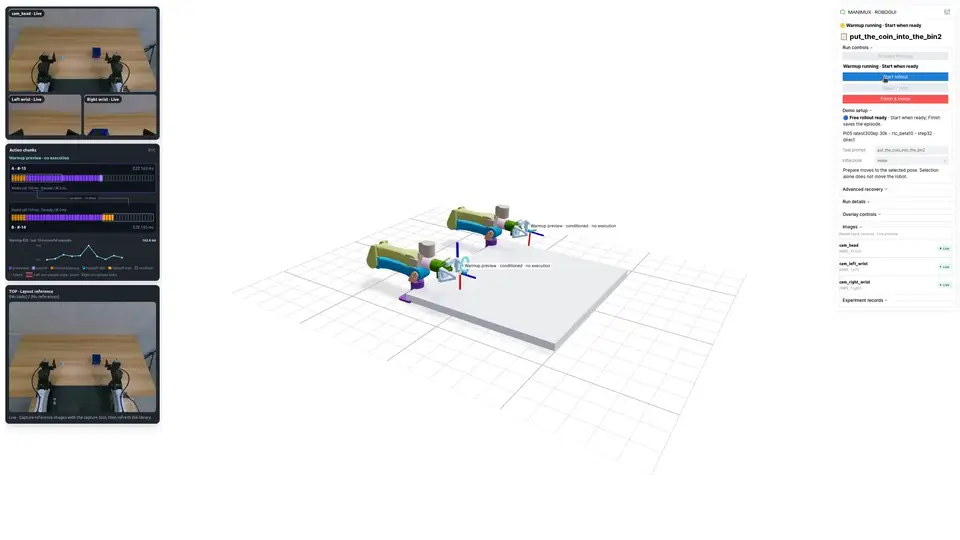
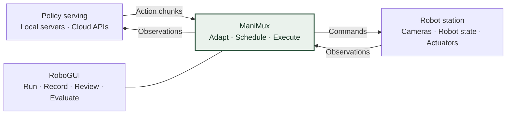

<div align="center">

<p><a href="https://sii-liulab.github.io/manimux/"></a></p>

### Real robot experiments. One inference harness.

An open-source harness for real-world manipulation inference and experiment management.

**[Website](https://sii-liulab.github.io/manimux/)** · **[Documentation](https://sii-liulab.github.io/manimux/guideline.html)** · **[Quick start](#quick-start)** · **[Demo](https://sii-liulab.github.io/manimux/#recordings)**

[](pyproject.toml)
[](LICENSE)
[](#contributing)
[](https://github.com/SII-LiuLab/manimux/stargazers)

</div>

[](assets/dream1-task-1440p30.mp4)

**Dream-1 on YAM, through RoboGUI.** Watch a real-robot run with live camera views,
robot state and predicted action chunks in one workspace.

[Watch the demo](assets/dream1-task-1440p30.mp4) · [Run Dream-1 on your station](manimux/configs/examples/dream1-yam/README.md)

<a id="what-you-can-do"></a>

## Why ManiMux

- **One deployment workflow.** Connect supported policies and robot stations through
  shared configuration, then inspect and control runs in RoboGUI.
- **Inference as an experiment variable.** Compare serial, asynchronous and
  model-supported sampling strategies while recording their configurations and execution traces.
- **Records you can revisit.** Keep trajectories, camera recordings and task-defined
  human evaluations together for replay, analysis and comparison.

## Architecture

ManiMux sits between policy servers and robot hardware, coordinating observation/action
adaptation, scheduling, execution, and experiment records. Model frameworks own inference;
RoboGUI provides the operator workspace.



[Architecture and extension protocols](.agents/skills/manimux-development/references/README.md) · [Inference guide](https://sii-liulab.github.io/manimux/guideline.html#algorithms)

<a id="integrate"></a>
<a id="included-integrations"></a>

<a id="integrations"></a>

## Feature Matrix

<table>
  <thead>
    <tr>
      <th>Embodiments</th>
      <th>Policies &amp; Frameworks</th>
      <th>Inference</th>
      <th>Agent Integration</th>
    </tr>
  </thead>
  <tbody>
    <tr valign="top">
      <td>
        <ul>
          <li><a href="https://sii-liulab.github.io/manimux/guideline.html#configuration">YAM</a></li>
          <li><a href="https://sii-liulab.github.io/manimux/guideline.html#configuration">Tianji–TacCap</a></li>
          <li><a href="manimux/embodiments/arm/franka/README.md">Franka FR3</a><br>Optional Robotiq gripper</li>
        </ul>
        <strong>Experimental</strong>
        <ul>
          <li>ARX X5</li>
          <li>PiPER</li>
        </ul>
      </td>
      <td>
        <strong>Policies</strong>
        <ul>
          <li><a href="manimux/configs/examples/dream1-yam/README.md">Dream-1 API</a></li>
          <li>Pi05 · Diffusion Policy</li>
          <li>GR00T · LingBot-VLA2 · XR-1</li>
        </ul>
        <strong>Frameworks</strong>
        <ul>
          <li>XPolicyLab · StarVLA</li>
        </ul>
        <a href="https://sii-liulab.github.io/manimux/guideline.html#support">Full support catalog →</a>
      </td>
      <td>
        <ul>
          <li><a href="https://sii-liulab.github.io/manimux/guideline.html#serial">Serial</a></li>
          <li><a href="https://sii-liulab.github.io/manimux/guideline.html#async">Async chunking</a></li>
          <li><a href="https://sii-liulab.github.io/manimux/guideline.html#rtc">RTC</a></li>
          <li><a href="https://sii-liulab.github.io/manimux/guideline.html#act-temporal-ensemble">ACT temporal ensemble</a></li>
          <li><a href="https://sii-liulab.github.io/manimux/guideline.html#paint">PAINT</a></li>
          <li><a href="https://sii-liulab.github.io/manimux/guideline.html#autohorizon">AutoHorizon</a></li>
        </ul>
        <a href="https://sii-liulab.github.io/manimux/guideline.html#optional-algorithm-composition">Supported combinations →</a>
      </td>
      <td>
        <a href="https://sii-liulab.github.io/manimux/guideline.html#agent-integrations"><strong>RPent / HarnessVLA</strong></a>
        <p>Planning through a shared Toolkit:</p>
        <ul>
          <li>Motion tools</li>
          <li>VLA calls</li>
        </ul>
        <p>Uses the ManiMux runtime and experiment lifecycle.</p>
      </td>
    </tr>
  </tbody>
</table>

Support varies by checkpoint, backend, adapter and station. These integrations do
not imply that every combination works; experimental ARX X5 and PiPER adapters
have not completed physical validation. See the linked guides for setup and validation scope.

## Quick start

Try RoboGUI without hardware. Requires **Python 3.11 or 3.12** and [uv](https://docs.astral.sh/uv/).

```bash
git clone https://github.com/SII-LiuLab/manimux.git
cd manimux
uv sync --dev
uv run manimux-robogui --robot yam --demo --host 127.0.0.1 --port 8086
```

Open **http://127.0.0.1:8086**. The preview uses synthetic data and does not connect
to a robot. Model environments and checkpoints are needed only for real deployment.

<a id="dream-1-hosted-inference"></a>

**Next, choose your workflow:**

| I want to… | Start here |
| --- | --- |
| Deploy a model on a real robot | [Station setup](https://sii-liulab.github.io/manimux/guideline.html#configuration) → [Deployment recipes](https://sii-liulab.github.io/manimux/guideline.html#support) |
| Run Dream-1 through its cloud API | [Dream-1 on YAM](manimux/configs/examples/dream1-yam/README.md) |
| Compare methods and evaluate runs | [Experiment workflow](https://sii-liulab.github.io/manimux/guideline.html#experiments) · [Records & replay](https://sii-liulab.github.io/manimux/guideline.html#records) |

<a id="contributing"></a>

## Contributing & community

Contributions to robot and policy integrations, inference strategies, RoboGUI,
and documentation are welcome. Start with the [contribution guide](.agents/skills/manimux-development/references/README.md#contributing).
For agent-assisted development, use the [development skill](.agents/skills/manimux-development/SKILL.md).

**Latest update · 2026-10-18:** The [ManiMux website](https://sii-liulab.github.io/manimux/) and dedicated [user guide](https://sii-liulab.github.io/manimux/guideline.html) are live.

<a id="developer-community"></a>

<details>
<summary>Join the developer WeChat group</summary>

Join the **ManiMux developer WeChat group** to discuss integrations, experiments,
and contributions. Open the invitation below and scan it in WeChat.

<p align="center">
  
</p>

This invitation is valid until **October 28, 2026**. If it has expired, please open
[a GitHub issue](https://github.com/SII-LiuLab/manimux/issues) to request an updated invitation.

</details>

## Citation

If ManiMux supports your research, please cite this repository. The paper link is forthcoming.

```bibtex
@misc{manimux2026,
  title = {{ManiMux}: An Open-Source Harness for Real-World Manipulation Inference and Experiment Management},
  year = {2026},
  howpublished = {GitHub repository},
  url = {https://github.com/SII-LiuLab/manimux}
}
```

Please also cite the components, models and methods used in your work:
[XPolicyLab](https://github.com/XPolicyLab/XPolicyLab), [StarVLA](https://github.com/starVLA/starVLA) and [PRM-as-a-Judge](https://github.com/YuyangLiu2003/PRM-as-a-Judge).

## License

ManiMux is licensed under [MIT](LICENSE). Third-party frameworks, SDKs and assets
retain their own licenses; see [third-party notices](licenses/THIRD_PARTY_NOTICES.md).
