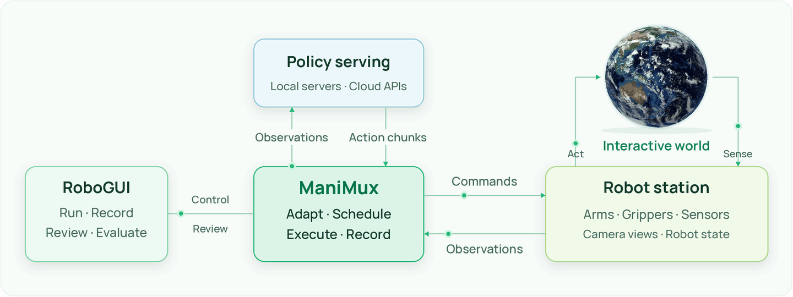

<div align="center">

<p><a href="https://sii-liulab.github.io/manimux/"></a></p>

### 真实机器人实验。一套推理与部署 Harness。

面向真实世界操作的开源推理与实验管理框架。

**[网站](https://sii-liulab.github.io/manimux/)** · **[文档](https://sii-liulab.github.io/manimux/guideline.html)** · **[快速开始](#快速开始)** · **[离线 GUI](#离线体验-robogui)** · **[English](README.md)**

[](pyproject.toml)
[](LICENSE)
[](README.md#contributing)
[](https://github.com/SII-LiuLab/manimux/stargazers)

</div>

[](https://sii-liulab.github.io/manimux/assets/dream1-task-1440p30.mp4)

**YAM 上的 Dream-1，经 RoboGUI 操作。** 同一工作区查看相机画面、机器人状态与预测动作块。

## 动态

- **2026-10-30** — 新增 [ChunkTrust AHS](https://sii-liulab.github.io/manimux/guideline.html#chunktrust)，自适应选择动作块执行步数，并为 RTC+AHS 加入后端能力检查（[PR #25](https://github.com/SII-LiuLab/manimux/pull/25)）。新增 [Poke-Aurora API 支持](https://sii-liulab.github.io/manimux/guideline.html#poke-api)及需完成标定的 YAM 示例，无需本地模型服务。

- **2026-10-22** — 支持 [Franka FR3 + Robotiq 夹爪](https://sii-liulab.github.io/manimux/guideline.html#franka-deployment) 与 [RPent agent](https://sii-liulab.github.io/manimux/guideline.html#agent-integrations)。

## 为什么选择 ManiMux

- **统一部署流程。** 用共享配置连接策略与工位，在 RoboGUI 中查看并控制实验。
- **把推理当作实验变量。** 对比串行、异步与模型侧采样策略，并保留配置与执行轨迹。
- **可回看的记录。** 轨迹、相机录像与任务定义的人工评分集中存放，便于回放与对比。

## 架构

ManiMux 位于策略服务与机器人硬件之间，负责观测/动作适配、调度、执行与实验记录。模型框架负责推理；RoboGUI 提供操作界面。



[架构与扩展协议](skills/manimux-development/references/README.md) · [推理指南](https://sii-liulab.github.io/manimux/guideline.html#algorithms)

完整功能矩阵（本体 / 策略 / 推理）见 [英文 README](README.md#feature-matrix)。
其中包括 [Poke-Aurora API](https://sii-liulab.github.io/manimux/guideline.html#poke-api)（需完成工位标定）和 [ChunkTrust AHS](https://sii-liulab.github.io/manimux/guideline.html#chunktrust)：串行 AHS 需要支持 denoising trace 的后端；RTC+AHS 已集成运行时，但 RTC+trace 真实后端仍待验证。

## 快速开始

需要 **Python 3.11 或 3.12**，以及 [uv](https://docs.astral.sh/uv/)。

### 离线体验 RoboGUI

用合成数据启动操作界面——**无需机器人、相机或模型服务**。核心参数是 `--robot yam --demo`。

```bash
git clone https://github.com/SII-LiuLab/manimux.git
cd manimux
uv sync --dev
uv run manimux-robogui --robot yam --demo --host 127.0.0.1 --port 8086
```

浏览器打开 **http://127.0.0.1:8086**。

| 参数 | 含义 |
| --- | --- |
| `--robot yam` | 使用 YAM 的 RoboGUI 预设（也可选 `piper`、`aloha`、`tianji`） |
| `--demo` | 用合成关节/相机数据驱动界面，不访问真实硬件 |
| `--host` / `--port` | 本地 Web UI 绑定地址 |

其他预设示例：

```bash
uv run manimux-robogui --robot piper --demo --host 127.0.0.1 --port 8087
uv run manimux-robogui --robot aloha --demo --host 127.0.0.1 --port 8087
```

模型环境与 checkpoint 仅在真实机器人部署时需要。

### 真机一键启动全部服务

一次部署包含四个服务：**相机服务**、**模型服务**（Dream-1 等托管 API 无需本机模型服务）、**RoboGUI**，以及驱动机器人的 **runtime**。`manimux up` 会在各自的 tmux session 中全部拉起并占用当前终端。**Ctrl-C 会一并停止**（先停 runtime，再停其余服务）。

```bash
uv run manimux doctor --config <experiment.yaml> \
  --runtime-python envs/yam/.venv/bin/python --policy-python <model-env>/bin/python  # 只读检查
uv run manimux up --config <experiment.yaml> \
  --runtime-python envs/yam/.venv/bin/python --policy-python <model-env>/bin/python --open
# ... 在 RoboGUI 中操作（Prepare → Start → Finish）...
# Ctrl-C  -> 停止 runtime、模型、相机与 RoboGUI
```

- Dream-1 等托管 API：省略 `--policy-python`，并先在本终端导出 API key。
- 其他终端可执行：`uv run manimux status`、`uv run manimux attach --service runtime`（分离：Ctrl-B 再按 D）。

手动分终端启动、Franka、外部模型/相机等说明见 [英文 README](README.md#start-the-services-by-hand) 与 [managed deployment](https://sii-liulab.github.io/manimux/guideline.html#managed-deployment)。

**按目标选择入口：**

| 我想… | 从这里开始 |
| --- | --- |
| 在真机上部署模型 | [工位配置](https://sii-liulab.github.io/manimux/guideline.html#configuration) → [部署配方](https://sii-liulab.github.io/manimux/guideline.html#support) |
| 通过云 API 跑 Dream-1 | [Dream-1 on YAM](manimux/configs/experiments/example-yam-dream1/README.md) |
| 通过 XPolicyLab 跑 Pi05 | [Pi05 on YAM](manimux/configs/experiments/example-yam-pi05/README.md) |
| 用 agent + VLA 规划（RPent） | [Dream-1 rpent](manimux/configs/experiments/example-yam-dream1/put_bottles/rpent.yaml) · [Pi05 rpent](manimux/configs/experiments/example-yam-pi05/put_bottles/rpent.yaml) |
| 对比方法并评估 | [实验流程](https://sii-liulab.github.io/manimux/guideline.html#experiments) · [记录与回放](https://sii-liulab.github.io/manimux/guideline.html#records) |

## 贡献与社区

欢迎贡献机器人/策略集成、推理策略、RoboGUI 与文档。请从 [贡献指南](skills/manimux-development/references/README.md#contributing) 开始；Agent 辅助开发可使用 [development skill](skills/manimux-development/SKILL.md)。

### 开发者微信群

加入 **ManiMux 开发者微信群**，讨论集成、实验与贡献。用微信扫描下方邀请二维码：

<p align="center">
  
</p>

邀请有效期至 **2026 年 11 月 5 日**。若已过期，请开 [GitHub issue](https://github.com/SII-LiuLab/manimux/issues) 索取新邀请。

## 引用

若 ManiMux 对你的研究有帮助，请引用本仓库（论文链接待发布）：

```bibtex
@misc{manimux2026,
  title = {{ManiMux}: An Open-Source Harness for Real-World Manipulation Inference and Experiment Management},
  year = {2026},
  howpublished = {GitHub repository},
  url = {https://github.com/SII-LiuLab/manimux}
}
```

相关组件请另引：[XPolicyLab](https://github.com/XPolicyLab/XPolicyLab)、[StarVLA](https://github.com/starVLA/starVLA)、[PRM-as-a-Judge](https://github.com/YuyangLiu2003/PRM-as-a-Judge)。

## 许可证

ManiMux 采用 [MIT](LICENSE)。第三方框架、SDK 与资源保留各自许可证，见 [third-party notices](licenses/THIRD_PARTY_NOTICES.md)。
